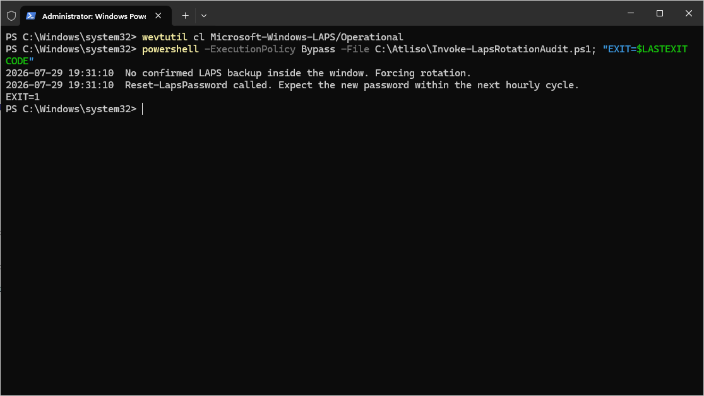
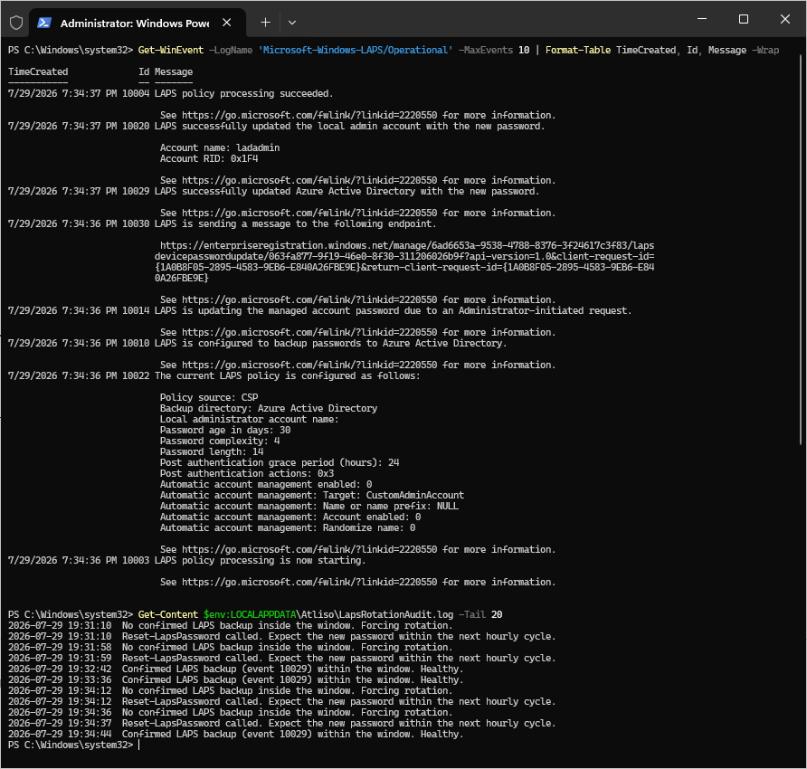
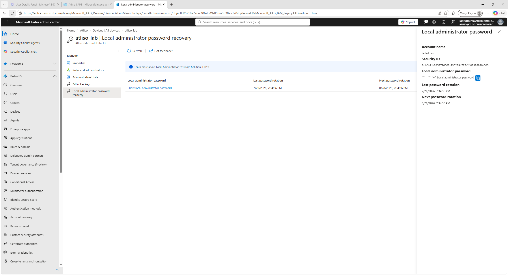

# LAPS Rotation Audit

[](https://www.powershellgallery.com/packages/Atliso-LapsRotationAudit)

PowerShell script that checks whether Windows LAPS is really rotating the local admin password, and forces a rotation when it is not.

Windows LAPS can show as compliant in Intune while the local admin password has not changed in months. Compliance only means a policy is assigned, not that a rotation succeeded. This script confirms a real backup happened inside the expected window, and forces a rotation when it did not.

## What it does

- Looks for the success event that matches your backup target: 10029 for Entra ID, 10018 for Active Directory
- Uses your policy's Password Age Days plus a small grace period as the window, so the check is based on your real setting, not a guess
- Flags event 10005 (policy processing failed), which means rotation is actively broken rather than just late
- Forces a rotation with `Reset-LapsPassword` when nothing is confirmed
- Reports only by default. Nothing changes until you set `-WhatIf $false`
- Logs every action to `%LOCALAPPDATA%\Atliso\LapsRotationAudit.log`

## Install

From the [PowerShell Gallery](https://www.powershellgallery.com/packages/Atliso-LapsRotationAudit):

```powershell
Install-Script Atliso-LapsRotationAudit -Scope CurrentUser
```

Or download `Atliso-LapsRotationAudit.ps1` from this repo or the [latest release](../../releases/latest).

## Quick start

1. Download [`Atliso-LapsRotationAudit.ps1`](Atliso-LapsRotationAudit.ps1)
2. Open the top of the script and set the config to match your LAPS policy:

```powershell
$BackupDestination = "EntraID"   # or "ActiveDirectory"
$PasswordAgeDays   = 30           # your policy's Password Age Days value
$GraceDays         = 2            # slack before "late" becomes "broken"
$WhatIf            = $true        # $false to actually force rotation
```

3. Run it to audit, then set `$WhatIf` to `$false` to force a rotation.

## Deploy in Intune

Deploy it as a Remediation so every device is checked on a schedule.

1. In the Intune admin center: **Devices > Scripts and remediations > Remediations** > Create.
2. Use the detection half (exits 1 when no successful backup is confirmed inside the window) as the detection script.
3. Use this script with `-WhatIf $false` as the remediation script.
4. Run as **SYSTEM**, **64-bit**.

Note: `Reset-LapsPassword` hands off to LAPS background processing. Windows LAPS wakes on a fixed hourly cycle, so the new password appears within the next hour, not instantly.

## What it looks like

Detection on a device that has not rotated:



Remediation forcing the rotation:



The new password showing in the Intune LAPS recovery blade:



## Requirements

- Windows 10 or 11 with Windows LAPS
- PowerShell 5.1 or later
- A Windows LAPS policy assigned from Intune
- Rights to call `Reset-LapsPassword` (runs as SYSTEM under Intune)

## Full guide

Step by step, with screenshots: https://atliso.com/blog/windows-laps-password-not-rotating-fix

## License

MIT. Free to use, change, and ship. See [LICENSE](LICENSE).
